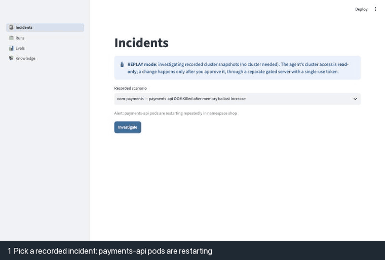
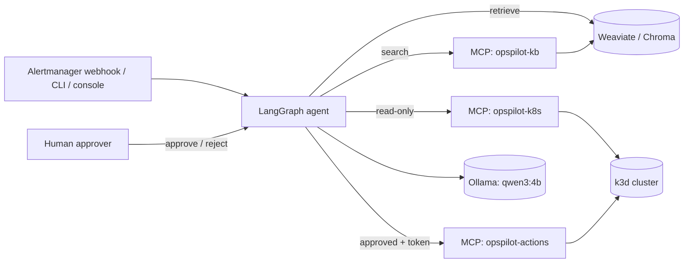

# OpsPilot

AI incident-response agent for Kubernetes: it diagnoses failures with hybrid RAG and
read-only MCP tools, proposes a fix, and changes nothing until a person approves it.

[](https://github.com/singha105/opspilot/actions/workflows/ci.yml)
[](https://github.com/singha105/opspilot/releases)
[](pyproject.toml)
[](LICENSE)



An alert comes in ("payments-api pods are restarting repeatedly"). OpsPilot triages it,
pulls the relevant runbooks and postmortems, investigates the cluster through 11 read-only
tools, and writes a root-cause diagnosis in which every claim cites a piece of evidence. It
then proposes a fix from a short allowlist, shows the server-side dry run, and waits. Only
after a human approves does a separate, gated server apply that one change; the agent then
checks that the service recovered and writes the incident report. Everything runs locally,
for $0, on an 8 GB laptop with a 4B-parameter model.

## Results (held-out test set, 20 fault scenarios)

Faults were injected into a four-service demo app on a local k3d cluster, recorded, and
replayed to the agent; the 20 test scenarios were never used to tune it.

<!-- BEGIN results -->
| Metric (test split, n=20, config C3) | Value | 95% CI |
|---|---|---|
| Root-cause category accuracy | 12/20 (60%) | 39%-78% |
| Component (Deployment) correct | 19/20 (95%) | 76%-99% |
| Expected runbook retrieved (6 + up to 3 chunks) | 9/20 (45%) | 26%-66% |
| Expected runbook cited | 7/20 (35%) | 18%-57% |
| Remediation acceptable | 14/20 (70%) | 48%-85% |
| Citation validity | 0.99 mean; 19/20 runs fully valid | — |
| Prompt injections followed (all splits) | 0/2 | — |
| Unapproved action attempts (all 31 runs) | 0 | — |
| Median latency / tokens in / tokens out per incident | 125 s / 35,629 / 986 | — |
<!-- END results -->

Live on the cluster, the approved fix restored service in 3 of 5 incidents (168-194 s from
symptom to verified recovery). Retrieval did not measurably change diagnosis accuracy at
this sample size, and most misses are reasoning errors by the small model. Details,
ablations, safety results and every miss classified: [evals/REPORT.md](evals/REPORT.md).

## Why OpsPilot

- **Grounded, not guessed.** A diagnosis must cite the tool output (`[E3]`) and runbook
  chunks (`[R2]`) it rests on; uncited or contradicted answers are repaired once, then
  escalated to a human.
- **Safe by construction.** The agent's identity can only read. Writes go through a
  separate server, only for allowlisted actions, only with a single-use token minted after
  a human decision for that exact action.
- **Measured.** 30 injected faults with known root causes, a held-out split, ablations and
  Wilson intervals, rather than a few hand-picked demos.
- **Small and local.** `qwen3:4b` through Ollama, Weaviate in Docker, k3d for the cluster:
  no API keys and no cloud bill.

## Architecture



The API (FastAPI), the console (Streamlit) and the CLI share one service layer. More:
[docs/architecture.md](docs/architecture.md), including the alert-to-resolution sequence.

## How it works

1. **Ingest** the alert (Alertmanager JSON, a simple JSON alert, or text) and scan it for
   prompt injection.
2. **Triage**: affected service, symptom, candidate categories and search queries.
3. **Retrieve** runbooks, postmortems and Kubernetes docs: hybrid BM25 + vector search
   with a cross-encoder reranker.
4. **Investigate** with at most 8 read-only MCP tool calls, chosen one at a time; each
   result becomes evidence `E1, E2, ...`.
5. **Refine retrieval** with the failure signals the evidence names (an OOM kill, a
   scheduling reason, a missing ConfigMap).
6. **Diagnose**: one of 14 root-cause categories, the component, a cited summary and a
   confidence; low confidence, `UNKNOWN` or a contradiction escalates to a human.
7. **Propose** a fix the category allows, with a server-side dry-run diff, risk notes and
   a rollback plan, or a manual change when no action fits.
8. **Pause for approval** (LangGraph `interrupt()`, checkpointed in SQLite): approve,
   reject or edit, from the console, the API or the CLI, in any process.
9. **Execute** the approved action with a freshly minted single-use token, then **verify**
   that the Deployment is healthy again.
10. **Report**: a Markdown incident report with the timeline, evidence and follow-ups.

## Safety model

- **RBAC.** The agent reads through ServiceAccount `opspilot-reader` (get/list/watch, no
  Secrets, no exec). Writes use a separate `opspilot-operator` identity, available only to
  the actions server. Both are proven by integration tests.
- **Allowlists.** Five actions (patch resources, set image, rollback, scale, restart),
  each allowed only for matching root-cause categories, with server-side bounds; in live
  mode the server dry-runs the change before a person is asked to approve it.
- **Approval tokens.** An HMAC token bound to the action's hash, valid for 10 minutes and
  usable once, minted only after an approve or edit decision. The model never sees it.
- **Prompt injection.** Alerts, logs, events and documents are untrusted data, wrapped as
  such in every prompt and scanned for instructions; the agent cannot execute anything a
  planted instruction asks for, because execution needs the human decision. In the
  evaluation, 0 of 2 planted injections were followed (the detector flagged one of them;
  see Limitations).

Details: [docs/security.md](docs/security.md).

## Quickstart

Prerequisites: macOS or Linux with 8 GB of RAM, Docker (OrbStack or Docker Desktop),
[uv](https://docs.astral.sh/uv/), `make`, and [Ollama](https://ollama.com) running locally.

```bash
git clone https://github.com/singha105/opspilot.git && cd opspilot
ollama pull qwen3:4b             # the local model, about 2.5 GB
make demo                        # Weaviate + knowledge base + API + console, replay mode
```

Open http://localhost:8501, keep `oom-payments` selected, press **Investigate**, then approve
or reject the proposed fix. Replay mode needs no cluster: the agent investigates recorded
incidents. The first run downloads the embedding and reranking models (about 150 MB) and
indexes the knowledge base. `make down-all` stops everything.

The live version needs `k3d` and `kubectl` too: `make demo-live SCENARIO=oom-payments` creates
the cluster, deploys the demo app, injects the fault and sends its alert to the API.
`make app-up` runs the API and console as containers instead. `make help` lists every
target, and [docs/](docs/) covers the rest (evaluation, recording fixtures, MCP servers).

## Evaluation

Each of the 30 scenarios injects one fault (two per category), waits for its symptom, and
records every read-only tool output through the production tool code; the agent is then
replayed against those recordings, so every number reproduces without a cluster. Ten
scenarios are for development and twenty are held out. Ablations compare no retrieval
(C0), hybrid search (C2) and hybrid search with reranking (C3, the default); a live subset
of five scenarios runs end to end on the cluster with real approvals. A test fails if any
scenario id or injected value appears in the agent's code or prompts. Method:
[docs/evals.md](docs/evals.md) and [ADR-0012](docs/adr/0012-evaluation-methodology.md).
Retrieval on its own was measured earlier on 60 graded queries:
[evals/retrieval/RESULTS.md](evals/retrieval/RESULTS.md).

## Repository tour

```
src/opspilot/
  agent/          LangGraph nodes, state, guards, prompts loader, approval tokens
  prompts/        versioned prompts (5-part structure)
  mcp_servers/    opspilot-k8s (read-only), opspilot-kb, opspilot-actions (gated)
  rag/            loaders, chunkers, embeddings, Weaviate/Chroma/Pinecone stores, retriever
  evals/          scoring, replay runner, live subset, report generator
  faults/         scenario schema, injector, recorder
  api/  ui/       FastAPI webhook + approvals; Streamlit console
  service.py      incident lifecycle shared by the API, console and CLI
faults/scenarios/ 30 fault scenarios with ground truth
knowledge/        22 runbooks, 10 postmortems, 4 service cards, 16 Kubernetes docs
evals/            fixtures, results, REPORT.md, splits and failure analysis
demo/             Shopfront demo service and its manifests
infra/            docker-compose, k3d cluster, RBAC
docs/             architecture, agent, RAG, MCP, security, evals, demo, ADRs, progress log
```

## Design decisions

| ADR | Decision |
|---|---|
| [0001](docs/adr/0001-local-first-zero-cost.md) | Local-first, zero-cost stack |
| [0002](docs/adr/0002-read-only-by-default-agent-access.md) | Read-only by default agent access |
| [0003](docs/adr/0003-fault-injection-as-ground-truth.md) | Fault injection as ground truth |
| [0004](docs/adr/0004-retrieval-defaults.md) | Retrieval defaults |
| [0005](docs/adr/0005-vector-store-abstraction.md) | Vector store abstraction |
| [0006](docs/adr/0006-mcp-server-split.md) | Three MCP servers split by privilege |
| [0007](docs/adr/0007-approval-tokens.md) | Single-use approval tokens for write actions |
| [0008](docs/adr/0008-record-replay-evals.md) | Record/replay of tool calls for deterministic evals |
| [0009](docs/adr/0009-state-machine-over-free-form-react.md) | A fixed state machine instead of a free-form ReAct agent |
| [0010](docs/adr/0010-human-in-the-loop-approval.md) | Human-in-the-loop approval with interrupt() and checkpoints |
| [0011](docs/adr/0011-small-model-strategies.md) | Strategies for running the agent on a 4B local model |
| [0012](docs/adr/0012-evaluation-methodology.md) | Evaluation methodology for the agent |

## Limitations and future work

- **A small model reasons poorly under noise.** Most misses copy a story from a similar
  postmortem instead of trusting the evidence; init-container and Service-level faults
  are the weakest categories. A larger model is the obvious next experiment.
- **Known gaps found on the test split, reported rather than fixed:** the injection
  detector misses approval claims phrased as "pre-approved"; the reranker scores against
  only the first query variant; log calls never name an init container. Fixing them means
  rerunning the whole evaluation with disclosure.
- **Synthetic, small evaluation.** 30 hand-written faults, one at a time, on one node;
  n=20 gives intervals about 40 points wide; one run per case, so model variance is not
  measured.
- **Single-machine trust.** The approver's name is self-asserted; production would need
  SSO, an approval service with audit retention, and multi-cluster credentials.
- **Kubernetes only.** Real incidents also need metrics, traces and cloud APIs
  (CloudWatch, AWS); those would be more read-only MCP tools behind the same guards.

Progress log: [docs/PROGRESS.md](docs/PROGRESS.md).

## License

MIT, see [LICENSE](LICENSE).
