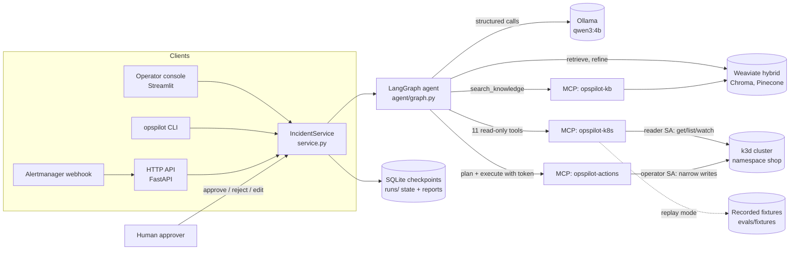
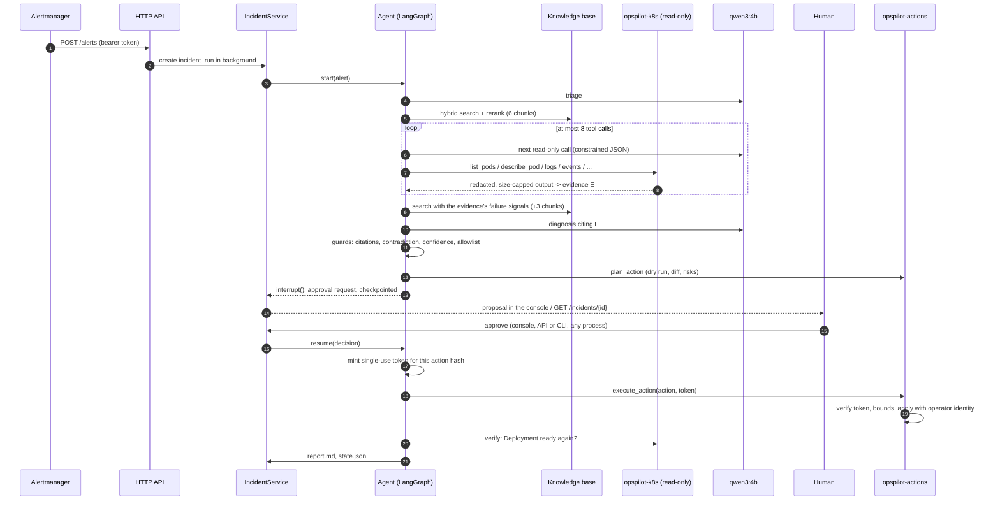

# Architecture

OpsPilot is a Python package (`src/opspilot`) with three entry points over one service
layer, a LangGraph agent, three MCP servers, and local infrastructure started by `make`.

## Components

| Component | Code | Role |
|---|---|---|
| HTTP API | `api/app.py` | `POST /alerts` (Alertmanager webhook or simple JSON), incident reads, `POST /incidents/{id}/approval`, `/healthz`; bearer token on writes |
| Operator console | `ui/app.py`, `ui/views.py` | Incidents, Runs, Evals and Knowledge pages |
| CLI | `cli.py`, `agent/cli.py` | `investigate`, `resume`, `runs`, `kb`, `faults`, `eval` |
| Service layer | `service.py` | create, run up to approval, resume from a decision, list and read incidents; one agent run at a time |
| Agent | `agent/` | 11-node state machine ([agent.md](agent.md), ADR-0009) |
| Prompts | `prompts/*.md` | versioned, 5-part prompts |
| Retrieval | `rag/` | chunking, fastembed embeddings, Weaviate/Chroma/Pinecone stores, RRF, FlashRank ([rag.md](rag.md)) |
| MCP servers | `mcp_servers/` | `opspilot-k8s` (read-only, live or replay), `opspilot-kb`, `opspilot-actions` (gated) ([mcp.md](mcp.md)) |
| Approval tokens | `agent/approval.py` | HMAC tokens bound to an action hash, single use, 10 minutes |
| Faults and evals | `faults/`, `evals/` | scenario injection and recording; scoring, replay runner, live subset, report |
| Infrastructure | `infra/`, `demo/` | Weaviate (and optional Phoenix, app containers) in compose; k3d cluster; Shopfront demo app; RBAC |

## From alert to resolution

## Where things run

| Piece | `make demo` (replay) | `make demo-live` | `make app-up` |
|---|---|---|---|
| API, console | host processes (uv) | host processes | containers (compose profile `app`) |
| Ollama | host | host | host, via `host.docker.internal` |
| Weaviate | container | container | container |
| Kubernetes | none: recorded fixtures | k3d cluster | none: recorded fixtures |
| Writes | none: approved actions are simulated | operator identity via the actions server | none |

State is on disk: `runs/<incident>/` holds `run.json`, `events.jsonl`, `state.json`,
`pending.json` while a decision is due, and `report.md`; `data/checkpoints.sqlite` holds the
LangGraph checkpoints. Because every client goes through `IncidentService` and the state is
on disk, an incident started by the API can be approved in the console or with
`opspilot resume`.

## Design decisions

See the [ADR index](adr/README.md).
